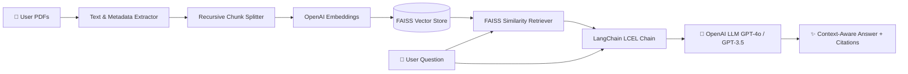

# ⚡ LangChain RAG-based PDF Query System

An intelligent Retrieval-Augmented Generation (RAG) system built with **LangChain**, **FAISS Vector Database**, **OpenAI Embeddings & LLMs**, and **Streamlit**. Upload multiple PDFs, automatically extract and chunk text with page-level citations, and query your documents via an interactive chat interface.

---

## ✨ Features

- 📑 **Multi-PDF Extraction**: High-fidelity text extraction and page metadata indexing with `pdfplumber`.
- ✂️ **Smart Semantic Chunking**: Configurable `RecursiveCharacterTextSplitter` preserving document context and source tracking.
- ⚡ **High-Speed Vector Search**: In-memory dense retrieval powered by `FAISS` and OpenAI's `text-embedding-3-small`.
- 🦜 **LangChain LCEL Pipeline**: Modular, production-ready Retrieval-Augmented Generation chain.
- 🔍 **Source Citations**: Every generated response includes expandable source citations with exact document names and page numbers.
- 🎨 **Modern Glassmorphic UI**: Sleek, responsive Streamlit dashboard with custom dark-mode styling, real-time metrics, and model parameter controls (model selector, temperature, top-k).

---

## 🏗️ Architecture



---

## 🚀 Quick Start

### 1. Clone the Repository
```bash
git clone https://github.com/your-username/RAG-based-PDF-Query-System.git
cd RAG-based-PDF-Query-System
```

### 2. Set Up Virtual Environment
```bash
# Windows
python -m venv env
env\Scripts\activate

# macOS/Linux
python3 -m venv env
source env/bin/activate
```

### 3. Install Dependencies
```bash
pip install -r requirements.txt
```

### 4. Configure Environment Variables
Copy the example `.env.example` file to `.env`:
```bash
cp .env.example .env
```
Open `.env` and add your OpenAI API key:
```text
OPENAI_API_KEY=sk-your-openai-api-key-here
```
*(Alternatively, you can also enter the API key directly in the Streamlit UI sidebar).*

### 5. Run the Application
```bash
streamlit run app.py
```
Open [http://localhost:8501](http://localhost:8501) in your browser.

---

## 📁 Project Structure

```text
├── app.py              # Streamlit Web App with Custom Glassmorphism UI
├── rag_chain.py        # LangChain RAG pipeline (FAISS + OpenAI + LCEL)
├── requirements.txt    # Project dependencies
├── .env.example        # Environment variable template (Safe for GitHub)
├── .gitignore          # Git ignore rules for secrets and temporary files
└── README.md           # Documentation
```

---

## 🛡️ Git & Security Best Practices

- **Never commit `.env`**: `.gitignore` is already pre-configured to ignore `.env`, `__pycache__`, and virtual environment directories.
- Share `.env.example` to let collaborators know which keys are required without exposing your credentials.

---

## 📜 License

This project is licensed under the MIT License.
